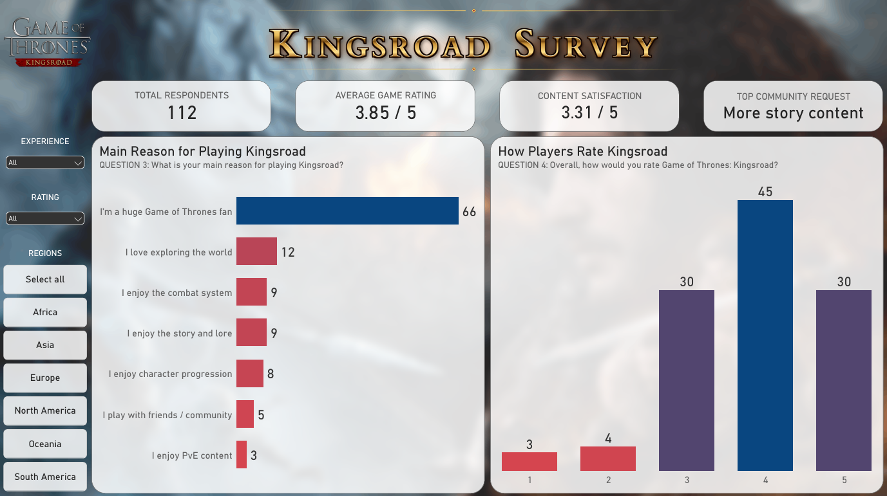
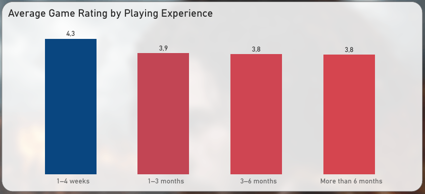
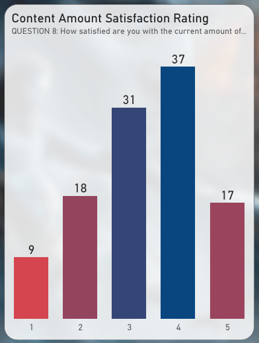
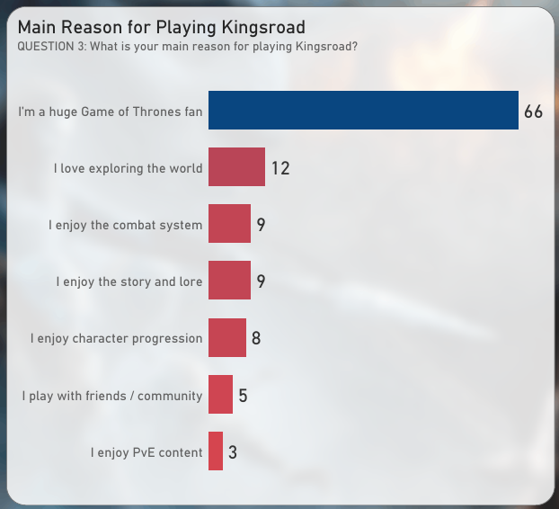

# Game of Thrones Kingsroad Community Survey - Case Study (#07)

###### This case study was developed entirely in **Power BI**, using **real survey data** collected from the Game of Thrones Kingsroad Community.

## Executive Summary:
I used **Power Query** to transform and prepare data for analysis, established relationships and cardinalities between the tables, created **DAX measures**, and built an interactive seven-page Power BI report.

Key highlights from the **Game of Thrones Kingsroad Community Survey** report:
1. **The majority of players in this survey (66%) have been playing Game of Thrones Kingsroad for over six months, making them veteran players and the backbone of the community. This also suggests that the game's marketing efforts may not be doing a great job of attracting new players.**
2. **The main reason players are playing Kingsroad is their love for the Game of Thrones franchise, with 58.9% of respondents (66 out of 112) selecting it as their primary motivation.**
3. **By far the two most requested updates are *new regions and locations to explore* (88 votes), followed by *more main story chapters* (80 votes). Delivering on these two requests could help revitalize the game, alongside addressing other needed fixes. Combined with effective marketing, these improvements could help attract both new and returning players.**

###### The final project is fully functional, connected, and tested, combining **data preparation, modeling, visualization, and analysis** in line with the core **PL-300 skills**.

## Objective:
The goal of this project is to analyze the Game of Thrones Kingsroad community through survey responses, focusing on player experience, satisfaction, motivations, and expectations for the game's future. The analysis aims to better understand the current player base, identify the game's strengths and weaknesses, and explore what improvements players would like to see in future updates.

**Key questions:**
1. **What is the main reason for playing Game of Thrones Kingsroad?**
2. **What needs the most improvement?**
3. **What should be added to Kingsroad in the future?**

 

## Methodology:
1. **Use Power Query to clean, transform, and prepare data for analysis**
2. **Establish table relationships, configure cardinalities & filter directions, and create DAX measures**
3. **Build an interactive Power BI report to visualize key metrics, player feedback, and insights**

## Power BI Skills:
**Power Query:** Data Cleaning, Transformation, Preparation, Custom Columns  
**Data Modeling:** Relationships, Cardinalities, Filters & Formatting  
**DAX:** Measures, Calculated Columns & Calculated Tables  
**Visualization:** Charts, Formatting, KPI Cards, Tooltips & Visual Calculations  
**Analysis:** KPI Analysis, Survey Analysis & Interactive Report Development

## Results & Recommendation:
This report provides an interactive overview of the **Game of Thrones Kingsroad community**, bringing together **player demographics, gaming habits, satisfaction, and feedback** in one place. It makes it easier to understand the current player base, identify areas for improvement, and evaluate what players expect from future updates. The findings also provide insights into potential opportunities to improve the game and attract new and returning players.

This report highlighted many key findings, some of them are:

* **Game Rating by Playing Experience:** Players who have been playing for **over six months** gave the game the lowest average rating of **3.8**, compared to newer players. This suggests that Kingsroad has the potential to make a positive first impression on new players, but player satisfaction may decline over time, potentially due to a lack of motivation, long-term engagement, or content to keep players invested.  
  

* **Content Amount Satisfaction Rating:** The amount of content in Kingsroad received an average rating of **3.31/5**. Somewhat concerning is that more players rated the amount of content with a 2 **(18 votes)** than with a 5 **(17 votes)**. This suggests that the game needs more engaging and appealing content to keep players interested. **PvP** was also mentioned in the final survey question, making it a potential feature worth considering for future updates.  
  

* **Main Reason for Playing Kingsroad:** The main reason players enjoy Kingsroad is their love for the Game of Thrones franchise **(66 out of 112 votes)**. Combined with players who primarily enjoy exploring the world **(12 votes)** and experiencing the story and lore **(9 votes)**, a total of **87 respondents (77.7%)** are primarily motivated by the traditional Game of Thrones experience. This suggests that many players are looking for a more traditional AAA open-world Game of Thrones game, similar in concept to Assassin's Creed. However, Kingsroad's focus on multiplayer elements, in-game progression systems, and pay-to-win mechanics may not fully align with these expectations.  
  

Based on this analysis, I would recommend the following actions:
1. **Improve Long-Term Player Retention:** Focus on keeping new and veteran players engaged through regular updates, events, and activities that give players a reason to return and continue playing.
2. **Expand Available Content:** Introduce more interesting and rewarding content, especially new regions, locations to explore, and additional main story chapters. Consider PvP, and Alliance content as another potential addition, given the interest expressed by the community.
3. **Reconsider Progression and Monetization:** Review in-game progression systems and monetization mechanics to ensure they do not negatively affect the player experience. Reduce excessive progression requirements and pay-to-win elements to make the game more enjoyable and accessible. Instead, explore alternative monetization opportunities by placing greater emphasis on cosmetic items such as character outfits, weapon skins, and mount skins, allowing players to support the game through customization without affecting gameplay balance.

I believe these recommendations could help improve the overall player experience, increase long-term player engagement, better meet community expectations, and make Kingsroad more appealing to both new and returning players.

## Next Steps:
1. **Expand the Analysis:** Collect additional survey responses to get a broader picture of the community and improve the reliability of the findings.
2. **Track Community Feedback Over Time:** Conduct follow-up surveys after major game updates to measure changes in player satisfaction, expectations, and overall game perception.
3. **Explore Player Segments:** Compare different player groups based on their playing experience, motivations, and satisfaction levels to identify what keeps new players interested and what could improve retention among veteran players.
